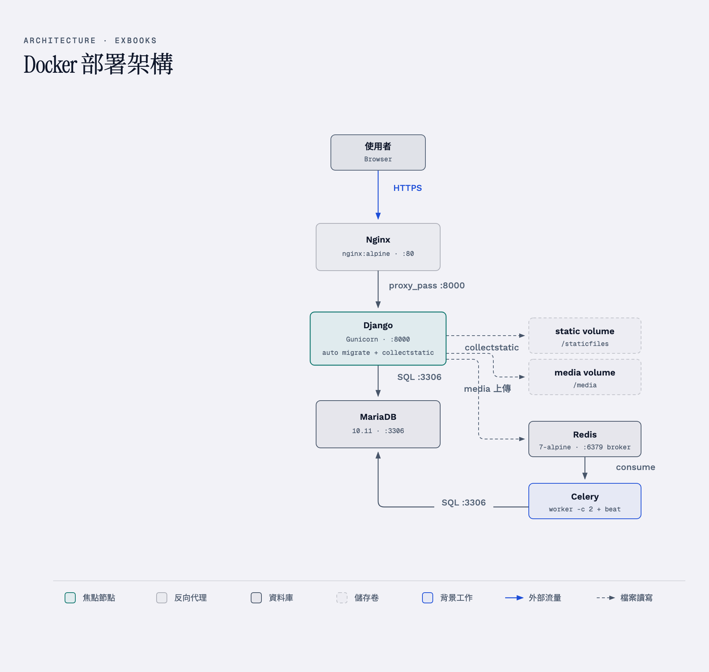

# Exbooks 共享書籍


> 一套公益性質的共享書籍平臺，鼓勵社群成員分享自有藏書，讓書籍自由流通，促進知識共享。

## 計劃主旨

透過社群成員自主分享書籍，建立一個去中心化的共享圖書平臺，讓書籍能夠自由流通，並促進社群成員之間的交流與知識共享。

近幾年共享經濟（Sharing Economy）火紅，已廣泛應用在環保、公益、商業等領域。本平臺以公益為出發點，鼓勵民眾加入社群，拿出自有藏書與他人交換閱讀。

## 核心概念

- **去中心化管理** — 書籍由用戶自行保管，無實體圖書館
- **雙軌流通模式** — 書籍可定義為「開放傳遞」或「閱畢即還」
- **面交取書** — 所有書籍交付一律採面交方式
- **信用評價** — 交易後雙方互評，建立社群信任機制
- **套書綁定** — 套書可綁定借出，避免分散難以追回

## 角色說明

| 角色 | 說明 |
|------|------|
| **會員 (Member)** | 註冊帳號，可上架書籍、申請借閱、評價交易對象 |
| **貢獻者 (Owner)** | 分享自有書籍並上架至平臺供他人借閱 |
| **持有者 (Keeper)** | 目前持有該書籍的用戶（不一定是貢獻者） |
| **讀者 (Reader)** | 申請借閱書籍的用戶 |
| **管理員 (SysAdmin)** | 維護平臺運作、審核異常交易 |

> Owner、Keeper、Reader 為情境角色，同一用戶可同時擁有不同角色身份。

## 技術架構

| 層級 | 技術 |
|------|------|
| 後端框架 | Django + Django REST Framework |
| 資料庫 | MariaDB |
| 身份驗證 | Django Auth / OAuth 2.0 (Google) / JWT |
| AI 服務 | vLLM（OpenAI 相容端點），未設定 API key 時自動 fallback 到 mock 回應 |

## 本地啟動

### 環境需求

- uv（Python 專案管理工具；Python 3.12 會由 uv 自動下載，無需手動安裝）

本地開發使用 SQLite（`exbook/dev_settings.py`），不需要 MariaDB；資料庫由 `migrate` 自動建立。

### 1. 安裝 uv

```bash
# macOS / Linux
curl -LsSf https://astral.sh/uv/install.sh | sh

# Windows (PowerShell)
powershell -ExecutionPolicy ByPass -c "irm https://astral.sh/uv/install.ps1 | iex"
```

> macOS 也可用 Homebrew：`brew install uv`。

### 2. 安裝依賴

```bash
# 正式依賴 + 開發工具（dev 群組預設安裝）
uv sync

# 再加上測試依賴（test 群組）
uv sync --group test
```

執行後會在專案根目錄建立 `.venv` 虛擬環境。你可以啟用這個環境：

```bash
# Windows
.venv\Scripts\activate

# macOS / Linux
source .venv/bin/activate
```

也可以不啟用，之後的指令直接用 `uv run <指令>` 執行。

### 3. 環境變數

複製範本（本地開發用預設值，不用編輯）：

```bash
cp .env.example .env
```

`.env.example` 是本地開發基準；AI、Email、Push、物件儲存等都是選填，未設定時自動停用或 fallback，詳見檔案內的必填/選填標註。

### 4. 執行遷移 & 建立管理員

`manage.py` 本地預設即 `exbook.dev_settings`（SQLite），直接執行即可：

```bash
python manage.py migrate
python manage.py seed
```

`seed` 會載入一批假資料（用戶、書籍、交易）並建立兩組**固定帳密的示範帳號**（email 已標記為驗證狀態，可直接登入）：

| 電子信箱 | 密碼 | 角色 |
|----------|------|------|
| `admin@example.com` | `admin12345` | 管理員（superuser，可進 `/admin/`） |
| `reader@example.com` | `reader12345` | 一般會員 |

> ⚠️ 示範帳號僅供本地開發使用，部署前請刪除或改用 `createsuperuser` 建立正式帳號。
> 重新執行 `seed` 會清除既有假資料（保留 superuser）後重新產生，帳號密碼不變。

### 5. 啟動開發伺服器

```bash
python manage.py runserver
```

開啟瀏覽器：
- 首頁：http://127.0.0.1:8000/
- 後台：http://127.0.0.1:8000/admin/

### 6. 執行測試

測試使用 /tmp 下的暫存 SQLite（`exbook/test_settings.py`），不需要 MariaDB：

```bash
pytest
```

> Browser e2e 測試需要 Playwright 瀏覽器：`uv run playwright install chromium`；未安裝時該 5 個測試檔會自動略過。

## Docker 部署

### 環境需求

- Docker Engine 24+
- Docker Compose V2+

### 1. 設定環境變數

```bash
cp .env.example .env
```

`.env.example` 是本地開發基準，Docker 部署時需改成生產設定：

```
DB_PASSWORD=你的資料庫密碼
SECRET_KEY=一段隨機長字串（必填）
DEBUG=False
SECURE_SSL_REDIRECT=True
ALLOWED_HOSTS=localhost,127.0.0.1
CSRF_TRUSTED_ORIGINS=http://localhost,http://127.0.0.1
CELERY_TASK_ALWAYS_EAGER=false
```

需要真寄信時另取消 `.env` 中 `EMAIL_*` 區塊的註解並填入 SMTP 憑證。

### 2. 啟動所有服務

```bash
docker compose up -d --build
```

這會啟動八個容器：

| 容器 | 用途 | 對外 Port |
|------|------|-----------|
| `db` | MariaDB 10.11 | — (內部 3306) |
| `web` | Django + Gunicorn | — (內部 8000) |
| `celery_worker` | Celery worker（排程與延遲任務） | — |
| `celery_beat` | Celery beat（排程觸發） | — |
| `nginx` | 反向代理 + 靜態檔案 | **80** |
| `redis` | Celery broker / 快取（AOF 持久化） | — (內部 6379) |
| `minio` | 物件儲存（備份落地） | 9002 (SAPI)、9003 (console) |
| `mailpit` | 本地 SMTP 捕獲（免真寄信） | 8025 (web UI) |

另有 `backup`、`media_backup`、`redis_backup` 三個備份服務，歸在 `backup` profile，需 `docker compose --profile backup up -d` 才會啟動。

首次啟動時 `web` 容器會自動執行 `migrate` 和 `collectstatic`。

### 3. 建立管理員帳號

```bash
docker compose exec web python manage.py createsuperuser
```

### 4. 存取

- 首頁：http://localhost/
- 後台：http://localhost/admin/

### 5. 常用指令

```bash
# 查看日誌
docker compose logs -f web

# 停止所有服務
docker compose down

# 停止並清除資料（含資料庫）
docker compose down -v
```

### 架構圖

使用者請求經 Nginx 反向代理（`:80`）轉發給 Django 應用容器（Gunicorn，內部 `:8000`），再連線至 MariaDB 資料庫容器（內部 `:3306`）；Django 同時讀寫 `static` 與 `media` 兩個 volume。排程與延遲任務由 Celery worker/beat 處理，以 Redis 為 broker；MinIO 承接備份，Mailpit 捕獲開發用郵件。



## CI/CD

本專案使用 GitHub Actions：`lint` 與 `test` 跑在 GitHub-hosted runner（fork 即可用）。`deploy` 使用 Self-hosted Runner，僅在上游 repo 觸發（fork 自動跳過，CI 以 lint/test 為完整流程）。

### 流程圖

```
開發者 git push
    │
    ▼
GitHub 觸發 webhook
    │
    ├─ [1] lint    — uv run ruff check .   （GitHub-hosted runner）
    ├─ [2] test    — uv run pytest         （GitHub-hosted runner）
    └─ [3] deploy  — docker compose build + up
                          （Self-hosted Runner，僅上游 repo push 到 master）
    │
    ▼
服務上線（Nginx :80）
```

> `docs/diagrams/ci-cd-flow.png` 繪製的是舊 pipeline（lint/test 皆 self-hosted），
> 重新產圖前以本圖為準。

### VM 環境準備（上游維護者操作，fork 不需要）

> 以 Ubuntu 22.04/24.04 為例，VM 最低規格：2 vCPU / 2 GB RAM / 25 GB Disk。

#### 1. 安裝 Docker

```bash
# 安裝 Docker Engine
curl -fsSL https://get.docker.com | sudo sh
sudo usermod -aG docker $USER

# 重新登入讓 docker 群組生效
exit
# 重新 SSH 進來

# 驗證
docker --version
docker compose version
```

#### 2. 安裝 GitHub Actions Runner

到你的 GitHub repo → Settings → Actions → Runners → **New self-hosted runner**，GitHub 會給你一組指令，大致如下：

```bash
# 建立 runner 目錄
mkdir ~/actions-runner && cd ~/actions-runner

# 下載（版本號依 GitHub 頁面提供的為準）
curl -o actions-runner-linux-x64.tar.gz -L \
  https://github.com/actions/runner/releases/download/v2.xxx.x/actions-runner-linux-x64.tar.gz
tar xzf actions-runner-linux-x64.tar.gz

# 設定（token 從 GitHub 頁面取得）
./config.sh --url https://github.com/你的帳號/exbooks --token YOUR_TOKEN

# 安裝為 systemd 服務（開機自動啟動）
sudo ./svc.sh install
sudo ./svc.sh start
sudo ./svc.sh status
```

#### 3. 部署專案

```bash
# 把 repo clone 到 VM
cd ~
git clone https://github.com/你的帳號/exbooks.git
cd exbooks

# 設定環境變數
cp .env.example .env
nano .env  # 填入 DB_PASSWORD, SECRET_KEY, ALLOWED_HOSTS 等

# 首次啟動
docker compose up -d --build
```

### Pipeline 說明

Pipeline 定義在 `.github/workflows/ci.yml`，分三個階段：

| 階段 | 觸發條件 | 執行內容 |
|------|----------|----------|
| **lint** | push / PR 到 master | `uv run ruff check .` 程式碼風格檢查 |
| **test** | lint 通過後 | `uv run pytest` 執行全部測試（未裝 Playwright 瀏覽器時 browser e2e 自動略過） |
| **deploy** | test 通過 + push 到 master | `scripts/deploy.sh` 重建並啟動容器 |

> PR 只會跑 lint + test，不會觸發 deploy。只有 merge 到 master 才會部署。

### GitHub Secrets 設定

目前的 pipeline 不需要 GitHub Secrets：lint/test 跑在 hosted runner（只用公開依賴），deploy 跑在 self-hosted Runner（用 runner 所在 VM 的環境）。之後若需要在 CI 使用敏感資訊，到 repo → Settings → Secrets and variables → Actions 新增。

## 文件索引

專案文件（需求、系統分析、圖表、可觀測性、測試、ADR、歷次簡報等）請見 [docs/index.md](docs/index.md)。
